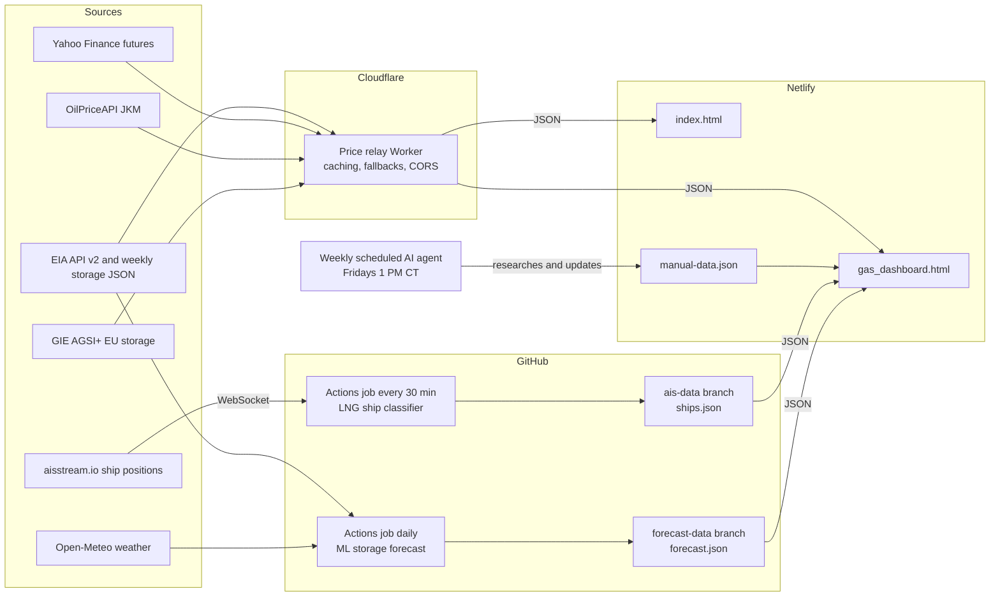

# Sanjo Consult: US Natural Gas Market Dashboard

A live US natural gas market dashboard and the Sanjo Consult home page, built and run on free services.

- **Home page:** WTI, Brent, Henry Hub, TTF and JKM prices, refreshed every minute.
- **Dashboard:** storage, supply, demand, infrastructure, market intelligence and LNG, updated automatically from EIA and other sources, with a weekly research update for figures that have no free data feed.

Live site: [www.sanjoconsult.com](https://www.sanjoconsult.com)

## Architecture



| Part | What it does |
|---|---|
| `worker/worker.js` | Cloudflare Worker (free plan). Fetches quotes and data server-side, caches them, and serves JSON to the site. Endpoints: `/` (prices), `?dashboard=1` (dashboard data), `?history=1` (weekly TTF and JKM history), `?debug=1` (readable output). |
| `site/index.html` | Home page with the live Markets section. |
| `site/gas_dashboard.html` | Dashboard. Ships with a built-in data snapshot, then replaces it with live data when the relay answers. |
| `scripts/ais/` | LNG ship tracker. `collect.mjs` listens to aisstream.io for 7 minutes; `classify.mjs` picks out LNG carriers and labels each one at a berth, anchored, inbound or outbound. Run every 30 minutes by `.github/workflows/ais.yml`, which publishes `ships.json` to the `ais-data` branch. |
| `ml/` | Weekly storage forecast in Python (scikit-learn): weather-driven gradient boosting and ridge regression, checked against the five-year average in a walk-forward backtest. Run daily by `.github/workflows/forecast.yml`. See [`ml/README.md`](ml/README.md). |
| `site/manual-data.json` | Figures with no free feed (rig counts, AGA indicators, regional basis, LNG feedgas, events, terminals, weekly JKM). Updated every Friday by a scheduled AI agent. |

### Design decisions

- **The page never breaks when a source does.** Each data section loads on its own. If a source fails, the dashboard keeps its built-in or last-known values and labels them with their date ("Not live · last updated …").
- **Secrets stay server-side.** API keys live in Cloudflare secrets (`EIA_API_KEY`, `AGSI_API_KEY`, `OILPRICE_API_KEY`), never in the site code.
- **Free-tier limits are respected.** The relay caches responses (60 seconds for prices, 10 minutes for dashboard data, 12 hours for history) and calls OilPriceAPI at most every two hours.
- **Every figure shows its date and source**, so a reader can tell live data from weekly or monthly data.
- **Ship tracking runs outside the browser.** aisstream.io does not accept browser connections and its key must stay secret, so a scheduled GitHub Actions job collects positions and publishes a small JSON file. It goes to a separate `ais-data` branch, replaced on each run, so `main` keeps a clean history and Netlify does not redeploy every 30 minutes.
- **LNG carriers are identified conservatively.** AIS has no "LNG carrier" ship type, so a ship counts if its name contains LNG, or if it is a tanker of 200 m or more stopped within 3 km of an LNG berth; that ship is then remembered when it sails. Large crude tankers offshore are not assumed to be LNG.
- **Licensed data is not scraped.** JKM comes from a licensed API; Investing.com and similar sites are not scraped.

## Data sources

| Data | Source | Refresh |
|---|---|---|
| Weekly storage, regions, 5-year average | EIA Weekly Natural Gas Storage Report (`ir.eia.gov/ngs/wngsr.json`) | Thursdays 9:30 AM CT |
| Storage history, Henry Hub spot, STEO forecasts, LNG exports by country | EIA API v2 | Weekly to monthly |
| Henry Hub (NYMEX NG front month), TTF, EUR/USD | Yahoo Finance | Every minute (delayed) |
| JKM | OilPriceAPI | Daily |
| EU storage | GIE AGSI+ | Daily |
| LNG carrier positions near Gulf Coast terminals | aisstream.io (free, terrestrial AIS receivers) | Every 30 minutes |
| ML storage forecast | EIA weekly storage and Open-Meteo temperatures | Daily |
| Rig counts, AGA indicators, basis, feedgas, events | Weekly AI research update | Fridays |

## Running the tests

```bash
npm install
npx playwright install chromium
npm test
pip install -r ml/requirements.txt && python -m pytest -q ml
```

- `tests/worker.test.mjs` tests the relay with mocked sources: contract-month selection, TTF conversion, storage report parsing, history aggregation and failure fallbacks.
- `tests/ais.test.mjs` tests the LNG ship classifier: message parsing, LNG identification, berth/anchored/inbound/outbound status, and how stale or distant ships are dropped.
- `ml/test_storage_forecast.py` (pytest) checks the forecast on synthetic data: degree-day sums, no look-ahead in the features, models beating the baseline, and the published file.
- `tests/dashboard.test.mjs` loads the dashboard in a headless browser with sample relay data and checks that every tab renders without errors, including a week with a zero storage change, the LNG ship map with live, old and missing ship data, and the forecast card.

Tests run on every pull request through GitHub Actions (`.github/workflows/ci.yml`).

## Deploying

- **Site:** Netlify publishes the `site/` folder (see `netlify.toml`). Connected to this repository, it redeploys on every merge to `main`.
- **Ship tracker:** needs a free aisstream.io API key saved as the repository secret `AISSTREAM_API_KEY` (Settings → Secrets and variables → Actions). Run it by hand from Actions → LNG ship positions → Run workflow.
- **Relay:** paste `worker/worker.js` into the `sanjo-prices` Worker in Cloudflare and deploy. Setup steps and secrets are in `worker/SETUP.txt`.

## How AI was used

The dashboard, relay and tests were designed and specified by Joseph George and built with an AI coding agent (Claude), which wrote most of the code under review. Every change was checked against real data, and the weekly figures with no free feed are researched by a scheduled AI agent that cites its sources and never invents values.
